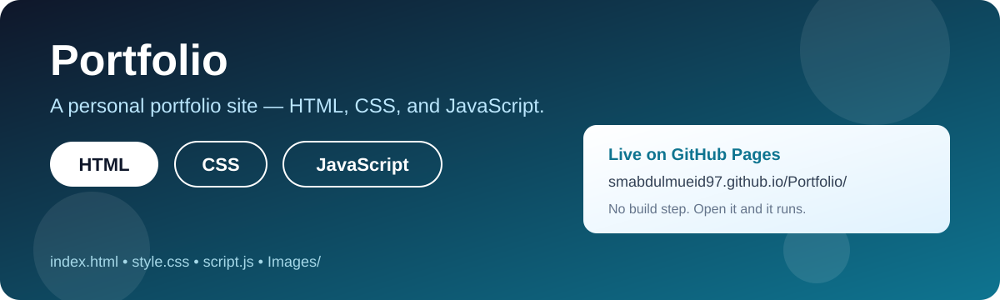

<p align="center">
  
</p>

<p align="center">
  <a href="https://smabdulmueid97.github.io/Portfolio/"></a>
  <a href="https://github.com/smabdulmueid97/Portfolio"></a>
  <a href="https://github.com/smabdulmueid97/Portfolio"></a>
  <a href="https://github.com/smabdulmueid97/Portfolio"></a>
  <a href="https://github.com/smabdulmueid97/Portfolio/stargazers"></a>
</p>

<h1 align="center">Portfolio</h1>

<p align="center">
  A personal portfolio site — plain <b>HTML, CSS, and JavaScript</b>, no build step, no framework.<br />
  🔗 <b><a href="https://smabdulmueid97.github.io/Portfolio/">smabdulmueid97.github.io/Portfolio/</a></b>
</p>

<p align="center">
  <a href="#-run-it">Run it</a> •
  <a href="#-whats-inside">What's inside</a> •
  <a href="#-make-it-yours">Make it yours</a>
</p>

---

## What it is

A single-page personal portfolio site. Three files do the whole job: markup, styling, and behaviour — plus an `Images/` folder for the site's images. It is hosted on GitHub Pages, so the live site updates whenever `main` updates.

## ▶️ Run it

No install, no build:

```bash
git clone https://github.com/smabdulmueid97/Portfolio.git
cd Portfolio
# Option 1: just open index.html in a browser
# Option 2: serve it locally
python3 -m http.server 8000
# then open http://localhost:8000
```

## 🗂️ What's inside

| File | What it does |
|---|---|
| `index.html` | The page — structure and content |
| `style.css` | The look — layout, colours, responsive styling |
| `script.js` | The behaviour — interactivity |
| `Images/` | Images used by the site |

## ✏️ Make it yours

| Change | Where |
|---|---|
| Text and sections | Edit `index.html` |
| Colours, fonts, layout | Edit `style.css` |
| Interactions | Edit `script.js` |
| Photos and graphics | Replace files in `Images/` (keep the same filenames, or update the references in `index.html`) |

Push to `main` and GitHub Pages picks it up — nothing else to deploy.

## License

This project is licensed under the MIT License — see the LICENSE file.
